# System Architecture

## AI-Powered Smart Hospital Management System

| Document Information | |
|---|---|
| **Project Name** | AI-Powered Smart Hospital Management System |
| **Version** | 1.0 |
| **Date** | July 21, 2026 |
| **Status** | Draft |
| **Prepared By** | Software Architecture Team |
| **Related Documents** | [SRS](../docs/SRS.md), [README](../README.md) |

---

## Table of Contents

1. [High-Level Architecture](#1-high-level-architecture)
2. [Why We Are Starting with a Modular Monolith](#2-why-we-are-starting-with-a-modular-monolith)
3. [Future Migration Plan to Microservices](#3-future-migration-plan-to-microservices)
4. [Major Modules](#4-major-modules)
5. [External Integrations](#5-external-integrations)
6. [Database Architecture](#6-database-architecture)
7. [Folder Structure Overview](#7-folder-structure-overview)
8. [Request Flow: React UI → Spring Boot → Database](#8-request-flow-react-ui--spring-boot--database)
9. [Deployment Architecture Using Docker](#9-deployment-architecture-using-docker)
10. [Future Kubernetes Deployment](#10-future-kubernetes-deployment)

---

## 1. High-Level Architecture

The system follows a **three-tier architecture** with a clear separation between presentation, business logic, and data layers. All business modules initially live inside a single Spring Boot application (modular monolith), while the React frontend communicates exclusively through REST APIs.

### 1.1 Architecture Diagram

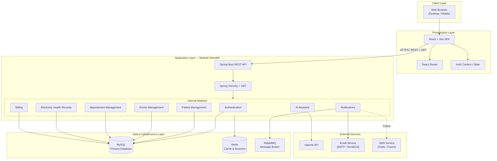

### 1.2 Layer Responsibilities

| Layer | Technology | Responsibility |
|---|---|---|
| **Client** | Web Browser | Renders the user interface; no business logic |
| **Presentation** | React + Vite | UI components, routing, form validation, API calls |
| **Application** | Spring Boot | Business rules, security, orchestration, integrations |
| **Data** | MySQL, Redis, RabbitMQ | Persistent storage, caching, async messaging |
| **External** | OpenAI, Email, SMS | AI processing and outbound communications |

### 1.3 Communication Patterns

| Pattern | Usage |
|---|---|
| **Synchronous REST** | Frontend ↔ Backend; Backend ↔ OpenAI (AI requests) |
| **Database queries** | Backend ↔ MySQL via Spring Data JPA |
| **Cache reads/writes** | Backend ↔ Redis for sessions, frequently accessed data |
| **Async messaging** | Backend publishes events to RabbitMQ; Notification module consumes them |
| **Webhooks / SMTP** | Backend ↔ Email and SMS providers |

---

## 2. Why We Are Starting with a Modular Monolith

A **modular monolith** is a single deployable application internally organized into well-defined, loosely coupled modules. Each module has its own packages, services, and boundaries—but shares one runtime, one database (initially), and one deployment pipeline.

### 2.1 Definition

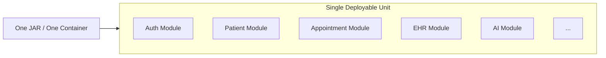

Unlike a traditional "big ball of mud" monolith, a **modular** monolith enforces clear boundaries between domains. Modules communicate through well-defined service interfaces—not direct database access across domains.

### 2.2 Reasons for This Approach

| Reason | Explanation |
|---|---|
| **Faster time to market** | One codebase, one deployment, one team can deliver MVP quickly without the overhead of distributed systems |
| **Simpler operations** | No service discovery, no inter-service networking, no distributed tracing required on day one |
| **Easier debugging** | Single process, unified logs, straightforward local development |
| **Lower infrastructure cost** | One application server and one database for initial deployment |
| **Team size fit** | Small to medium teams benefit from shared context and simpler coordination |
| **Proven migration path** | Well-bounded modules can be extracted into microservices later without rewriting everything |
| **Transactional consistency** | Cross-module operations (e.g., book appointment + create billing record) stay within a single database transaction |

### 2.3 Modular Monolith vs Microservices (At Launch)

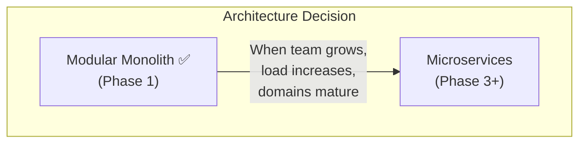

| Criteria | Modular Monolith (Now) | Microservices (Future) |
|---|---|---|
| Deployment units | 1 | 8+ independent services |
| Database | Shared MySQL (schema-separated) | Database per service |
| Inter-module calls | In-process method calls | HTTP/gRPC over network |
| Complexity | Low | High |
| Best for | MVP, early growth | Large scale, multiple teams |

### 2.4 Module Boundary Rules

To keep the monolith modular and migration-ready, we enforce these rules from day one:

1. **No cross-module database access** — Module A must not query Module B's tables directly; use service interfaces
2. **Package-by-feature** — Code is organized by domain (patient, appointment), not by technical layer (controller, service)
3. **Shared kernel only for common utilities** — DTOs, exceptions, and security config live in a shared package; business logic does not
4. **Events for side effects** — Use internal application events (later RabbitMQ) for notifications instead of tight coupling
5. **API-first module contracts** — Each module exposes a clear service interface that could become a REST endpoint later

---

## 3. Future Migration Plan to Microservices

Microservices are planned for **Phase 3** once the system reaches scale, team size, or isolation requirements that justify the added complexity. The modular monolith is intentionally structured to make this transition incremental—not a big-bang rewrite.

### 3.1 Migration Strategy: Strangler Fig Pattern

The **Strangler Fig Pattern** gradually replaces parts of the monolith by routing traffic to newly extracted services while the remaining system continues to run.

```mermaid
flowchart LR
    subgraph Phase1["Phase 1 — Modular Monolith"]
        Mono1["All modules in\none Spring Boot app"]
    end

    subgraph Phase2["Phase 2 — Hybrid"]
        Mono2["Core Monolith\n(Patient, EHR, Auth)"]
        Svc1["Notification\nService"]
        Svc2["AI Assistant\nService"]
    end

    subgraph Phase3["Phase 3 — Full Microservices"]
        API["API Gateway"]
        MS1["Auth Service"]
        MS2["Patient Service"]
        MS3["Appointment Service"]
        MS4["EHR Service"]
        MS5["Billing Service"]
        MS6["AI Service"]
        MS7["Notification Service"]
    end

    Phase1 --> Phase2 --> Phase3
```

### 3.2 Extraction Priority

Services will be extracted in order of **isolation benefit** and **lowest coupling**:

| Priority | Service | Rationale for Early Extraction |
|---|---|---|
| 1 | **Notification Service** | Already async via RabbitMQ; minimal coupling to core domains |
| 2 | **AI Assistant Service** | External API dependency; independent scaling for AI workloads |
| 3 | **Billing Service** | Distinct domain; may need separate compliance and release cycles |
| 4 | **Appointment Service** | High read/write volume; benefits from independent scaling |
| 5 | **Patient / EHR / Auth** | Core data domains; extracted last due to deep interdependencies |

### 3.3 Migration Steps (Per Service)

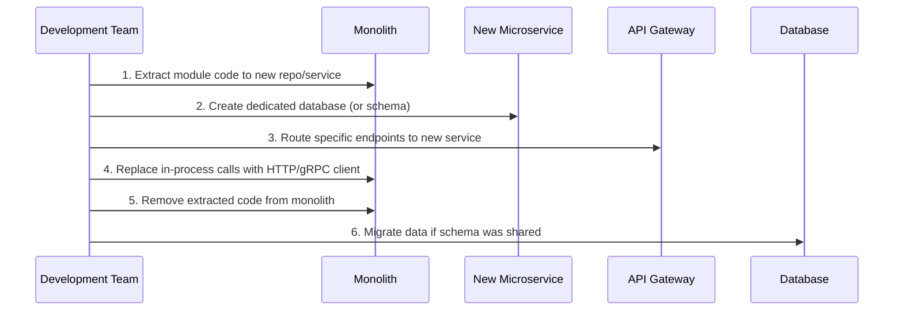

| Step | Action |
|---|---|
| 1 | Copy module code into a standalone Spring Boot project |
| 2 | Create a dedicated database or schema for the new service |
| 3 | Introduce an API Gateway to route traffic (`/api/notifications/*` → Notification Service) |
| 4 | Replace in-process service calls in the monolith with HTTP or gRPC clients |
| 5 | Remove the extracted module from the monolith |
| 6 | Migrate shared data and update foreign key relationships to use service IDs |

### 3.4 Infrastructure Evolution

| Phase | Infrastructure |
|---|---|
| Phase 1 | Docker Compose (single host) |
| Phase 2 | Docker Compose with multiple containers + API Gateway |
| Phase 3 | Kubernetes cluster with service mesh, auto-scaling, and observability stack |

---

## 4. Major Modules

The backend is divided into eight domain modules. Each module owns its business logic, service layer, and data access within the monolith.

### 4.1 Module Map

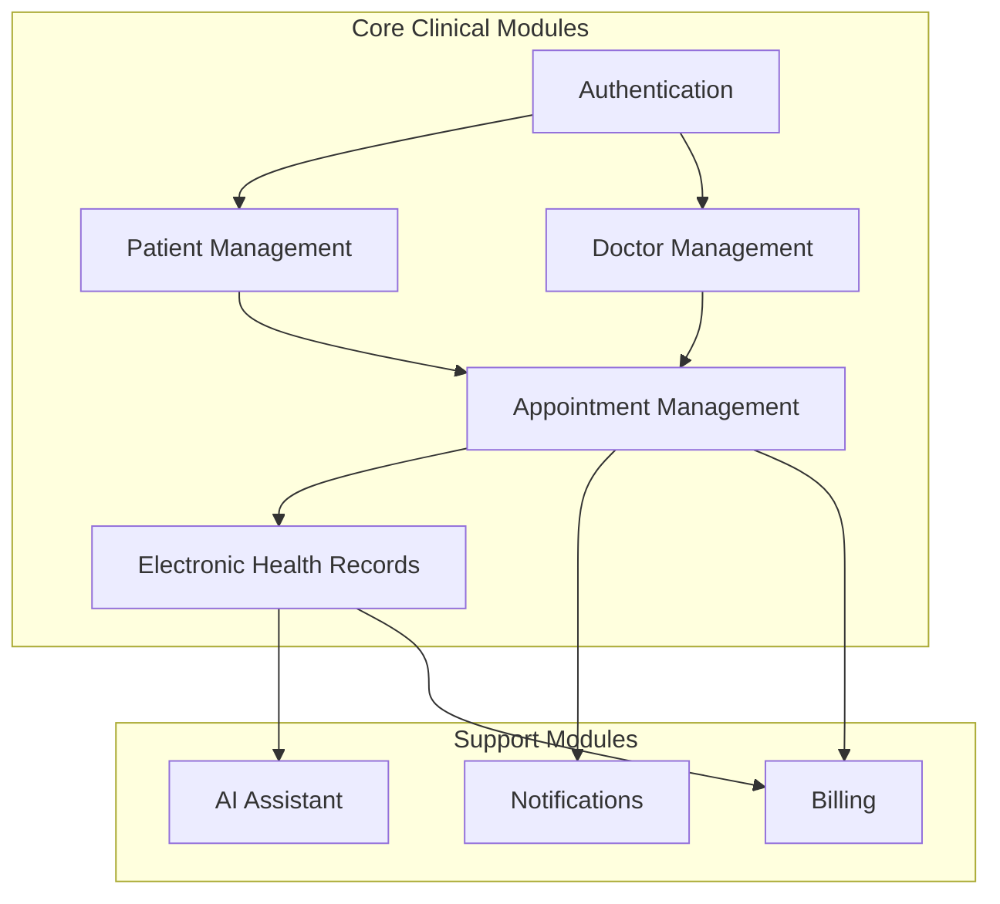

### 4.2 Module Descriptions

#### 4.2.1 Authentication

**Purpose:** Identity management, login, JWT issuance, and role-based access control.

| Aspect | Detail |
|---|---|
| **Key responsibilities** | User registration, login/logout, password reset, JWT token lifecycle, RBAC enforcement |
| **User roles managed** | Patient, Doctor, Receptionist, Admin |
| **Data owned** | Users, roles, permissions, refresh tokens, login audit logs |
| **Dependencies** | Redis (token blacklist, rate limiting) |
| **Exposed to frontend** | `/api/auth/login`, `/api/auth/register`, `/api/auth/refresh`, `/api/auth/logout` |

---

#### 4.2.2 Patient Management

**Purpose:** Patient demographics, profiles, medical history, and self-service portal features.

| Aspect | Detail |
|---|---|
| **Key responsibilities** | Patient CRUD, medical history (allergies, conditions), emergency contacts, patient search, timeline view |
| **Data owned** | Patients, medical history, emergency contacts, patient documents |
| **Dependencies** | Authentication (user linkage), EHR (visit history aggregation) |
| **Exposed to frontend** | `/api/patients/*`, `/api/patients/{id}/history`, `/api/patients/{id}/timeline` |

---

#### 4.2.3 Doctor Management

**Purpose:** Doctor profiles, specialties, schedules, and availability management.

| Aspect | Detail |
|---|---|
| **Key responsibilities** | Doctor profile CRUD, specialty/department assignment, weekly schedule configuration, leave management |
| **Data owned** | Doctors, specialties, departments, schedules, availability slots |
| **Dependencies** | Authentication (doctor user accounts), Appointment (schedule consumption) |
| **Exposed to frontend** | `/api/doctors/*`, `/api/doctors/{id}/schedule`, `/api/specialties/*` |

---

#### 4.2.4 Appointment Management

**Purpose:** Full appointment lifecycle—from booking and queue management to completion.

| Aspect | Detail |
|---|---|
| **Key responsibilities** | Slot generation, booking/rescheduling/cancellation, check-in, queue management, status workflow, AI slot recommendations |
| **Data owned** | Appointments, appointment slots, queue entries, appointment status history |
| **Dependencies** | Patient, Doctor, Notification (reminders), Billing (visit charges), AI (slot recommendations) |
| **Exposed to frontend** | `/api/appointments/*`, `/api/appointments/available-slots`, `/api/queue/*` |

**Appointment Status Flow:**

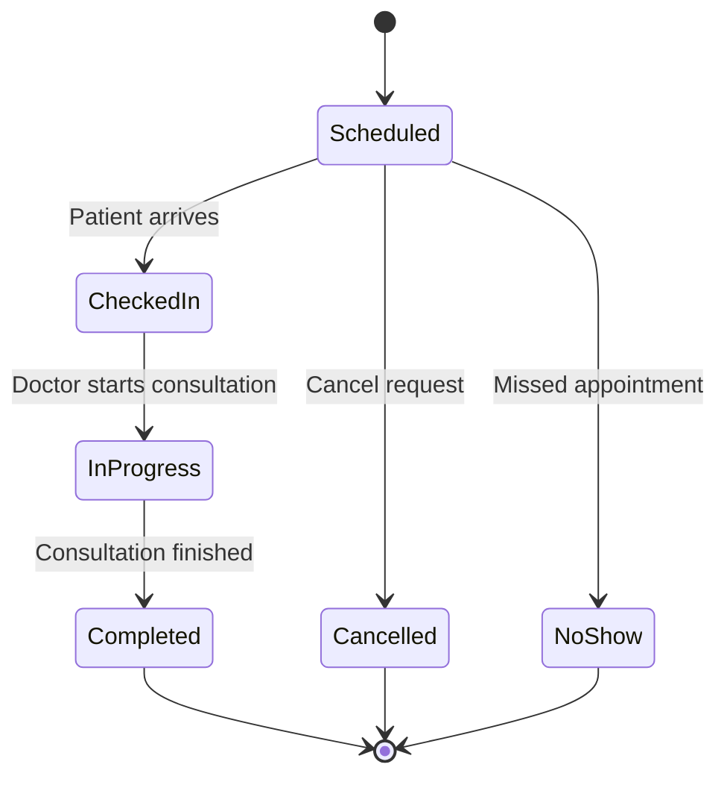

---

#### 4.2.5 Electronic Health Records (EHR)

**Purpose:** Secure storage and management of all clinical data.

| Aspect | Detail |
|---|---|
| **Key responsibilities** | Consultation notes, diagnoses, prescriptions, vitals, lab report attachments, audit trail |
| **Data owned** | Visits, diagnoses, prescriptions, vitals, lab reports, clinical notes |
| **Dependencies** | Patient (patient linkage), Appointment (visit context), AI (patient summaries) |
| **Exposed to frontend** | `/api/ehr/visits/*`, `/api/ehr/prescriptions/*`, `/api/ehr/vitals/*` |

---

#### 4.2.6 AI Assistant

**Purpose:** Intelligent features that augment clinical and operational workflows.

| Aspect | Detail |
|---|---|
| **Key responsibilities** | Symptom checker, appointment slot recommendations, patient summary generation, operational insights |
| **Data owned** | AI interaction logs, anonymized prompt/response cache |
| **Dependencies** | Patient, EHR, Appointment, OpenAI API |
| **Exposed to frontend** | `/api/ai/symptom-check`, `/api/ai/recommend-slots`, `/api/ai/patient-summary/{id}` |

> **Important:** AI outputs are assistive recommendations only. They are clearly labeled in the UI and never presented as definitive medical diagnoses.

---

#### 4.2.7 Notifications

**Purpose:** Reliable delivery of alerts and messages across channels.

| Aspect | Detail |
|---|---|
| **Key responsibilities** | Email dispatch, in-app notifications, template management, delivery queue processing |
| **Data owned** | Notification templates, notification queue, delivery logs, user preferences |
| **Dependencies** | RabbitMQ (async queue), Email Service, SMS Service (future) |
| **Exposed to frontend** | `/api/notifications/*`, `/api/notifications/preferences` |

**Notification Flow:**

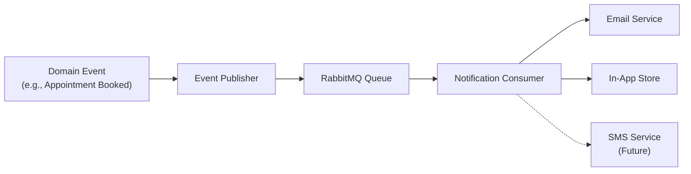

---

#### 4.2.8 Billing

**Purpose:** Patient billing, invoicing, and payment tracking for hospital services.

| Aspect | Detail |
|---|---|
| **Key responsibilities** | Invoice generation, line-item charges, payment status tracking, billing reports |
| **Data owned** | Invoices, invoice line items, payments, billing configurations (fee schedules) |
| **Dependencies** | Appointment (visit linkage), EHR (service codes), Patient (billing contact) |
| **Exposed to frontend** | `/api/billing/invoices/*`, `/api/billing/payments/*` |

> **Note:** Payment gateway integration (Stripe, Razorpay, etc.) is planned for a future phase. The initial release supports invoice generation and manual payment recording.

---

## 5. External Integrations

The system connects to third-party services for AI capabilities and outbound communications. All integrations are abstracted behind internal service interfaces so providers can be swapped without changing business logic.

### 5.1 Integration Overview

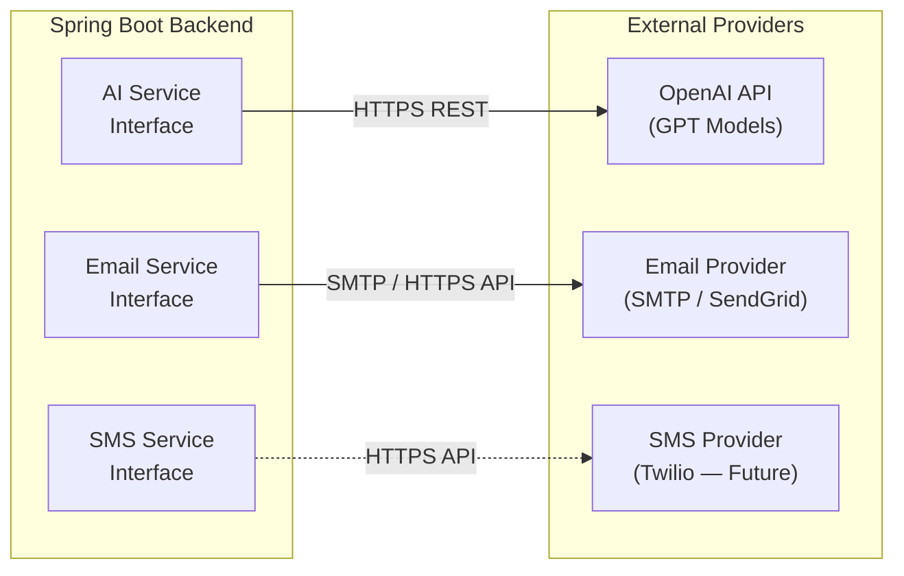

### 5.2 OpenAI API

| Aspect | Detail |
|---|---|
| **Purpose** | Power AI Assistant features (symptom analysis, patient summaries, slot recommendations) |
| **Protocol** | HTTPS REST (OpenAI Chat Completions API) |
| **Authentication** | API key stored in environment variables / secrets manager |
| **Data handling** | Minimize PII in prompts; log requests with correlation IDs; cache responses in Redis where appropriate |
| **Fallback** | If OpenAI is unavailable, AI features degrade gracefully with user-friendly error messages |
| **Rate limiting** | Application-level rate limits per user to control costs and prevent abuse |

**Integration Flow:**

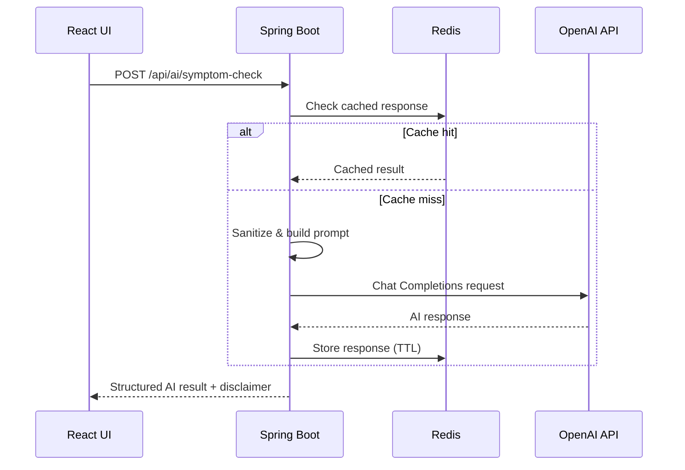

### 5.3 Email Service

| Aspect | Detail |
|---|---|
| **Purpose** | Appointment confirmations, reminders, password resets, billing receipts |
| **Protocol** | SMTP or provider REST API (e.g., SendGrid, Amazon SES) |
| **Authentication** | API key or SMTP credentials in environment variables |
| **Delivery model** | Async via RabbitMQ — domain events trigger email jobs |
| **Templates** | HTML email templates managed in the Notification module |

| Email Type | Trigger | Recipient |
|---|---|---|
| Appointment confirmation | Appointment booked | Patient |
| Appointment reminder | 24 hours before appointment | Patient |
| Password reset | Reset requested | User |
| Invoice receipt | Payment recorded | Patient |

### 5.4 SMS Service

| Aspect | Detail |
|---|---|
| **Purpose** | Urgent appointment reminders, OTP verification (future) |
| **Protocol** | HTTPS REST (e.g., Twilio, AWS SNS) |
| **Status** | Planned for Phase 2 — interface defined now, implementation later |
| **Authentication** | API key / account SID in secrets manager |
| **Fallback** | Email notification sent if SMS delivery fails |

### 5.5 Integration Design Principles

| Principle | Description |
|---|---|
| **Interface abstraction** | Business modules depend on interfaces (`EmailService`, `AIService`), not concrete providers |
| **Configuration-driven** | Provider selection via environment variables (`EMAIL_PROVIDER=sendgrid`) |
| **Retry with backoff** | Transient failures retried automatically; permanent failures logged and alerted |
| **Circuit breaker** | Prevent cascade failures when external services are down |
| **Secrets management** | API keys never stored in source code; injected at runtime |

---

## 6. Database Architecture

MySQL serves as the primary relational database. The schema is organized by domain module with clear table ownership, preparing for future schema or database separation during microservices migration.

### 6.1 Database Topology (Phase 1)

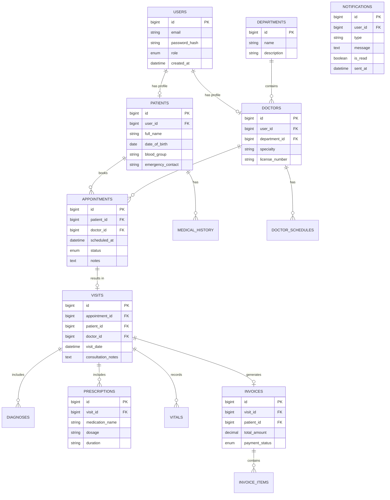

### 6.2 Schema Organization

Tables are grouped by owning module. Cross-module references use foreign keys but access is restricted to service-layer calls.

| Schema Group | Tables | Owning Module |
|---|---|---|
| **auth** | `users`, `roles`, `refresh_tokens`, `login_audit` | Authentication |
| **patient** | `patients`, `medical_history`, `emergency_contacts`, `patient_documents` | Patient Management |
| **doctor** | `doctors`, `departments`, `specialties`, `doctor_schedules`, `doctor_leaves` | Doctor Management |
| **appointment** | `appointments`, `appointment_slots`, `queue_entries` | Appointment Management |
| **ehr** | `visits`, `diagnoses`, `prescriptions`, `vitals`, `lab_reports` | EHR |
| **billing** | `invoices`, `invoice_items`, `payments`, `fee_schedules` | Billing |
| **notification** | `notifications`, `notification_templates`, `notification_preferences` | Notifications |
| **ai** | `ai_interaction_logs` | AI Assistant |

### 6.3 Caching Strategy (Redis)

| Data | Cache Key Pattern | TTL | Purpose |
|---|---|---|---|
| JWT blacklist | `jwt:blacklist:{tokenId}` | Token expiry | Invalidate logged-out tokens |
| Doctor availability | `doctor:slots:{doctorId}:{date}` | 15 minutes | Reduce slot query load |
| Patient profile | `patient:profile:{patientId}` | 30 minutes | Fast profile reads |
| AI responses | `ai:response:{hash}` | 1 hour | Avoid duplicate API calls |
| Session data | `session:{userId}` | 24 hours | User session state |

### 6.4 Database Conventions

| Convention | Rule |
|---|---|
| **Primary keys** | `BIGINT AUTO_INCREMENT` on all tables |
| **Timestamps** | `created_at`, `updated_at` on every table |
| **Soft deletes** | `deleted_at` nullable column where applicable |
| **Naming** | `snake_case` for tables and columns |
| **Migrations** | Version-controlled via Flyway or Liquibase in `/database/migrations/` |
| **Indexing** | Indexes on all foreign keys and frequently queried columns (email, status, scheduled_at) |

### 6.5 Future Database Separation (Microservices)

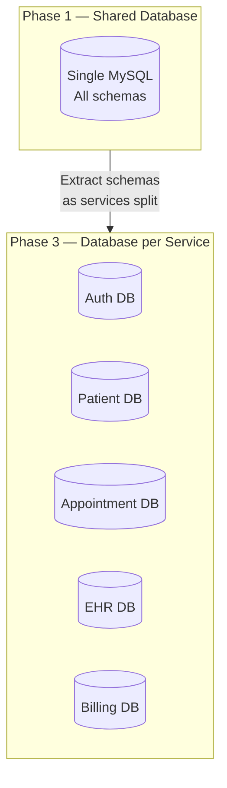

---

## 7. Folder Structure Overview

The repository is organized to reflect the modular monolith architecture, with clear separation between frontend, backend, infrastructure, and documentation.

### 7.1 Repository Layout

```
AI-Powered-Smart-Hospital-Management-System/
│
├── backend/                          # Spring Boot modular monolith
│   ├── src/
│   │   ├── main/
│   │   │   ├── java/com/hospital/
│   │   │   │   ├── HospitalApplication.java
│   │   │   │   ├── config/             # Security, Redis, RabbitMQ, CORS config
│   │   │   │   ├── shared/             # Common DTOs, exceptions, utilities
│   │   │   │   ├── auth/               # Authentication module
│   │   │   │   │   ├── controller/
│   │   │   │   │   ├── service/
│   │   │   │   │   ├── repository/
│   │   │   │   │   ├── model/
│   │   │   │   │   └── dto/
│   │   │   │   ├── patient/            # Patient Management module
│   │   │   │   ├── doctor/             # Doctor Management module
│   │   │   │   ├── appointment/        # Appointment Management module
│   │   │   │   ├── ehr/                # Electronic Health Records module
│   │   │   │   ├── ai/                 # AI Assistant module
│   │   │   │   ├── notification/       # Notifications module
│   │   │   │   └── billing/            # Billing module
│   │   │   └── resources/
│   │   │       ├── application.yml
│   │   │       ├── application-dev.yml
│   │   │       └── application-prod.yml
│   │   └── test/                       # Unit and integration tests
│   ├── Dockerfile
│   └── pom.xml
│
├── frontend/                           # React + Vite SPA
│   ├── src/
│   │   ├── main.jsx                    # Application entry point
│   │   ├── App.jsx                     # Root component with routing
│   │   ├── api/                        # Axios/fetch API client layer
│   │   ├── auth/                       # Auth context, login/logout hooks
│   │   ├── components/                 # Shared UI components
│   │   │   ├── common/                 # Buttons, modals, tables, forms
│   │   │   └── layout/                 # Navbar, sidebar, footer
│   │   ├── pages/                      # Route-level page components
│   │   │   ├── patient/                # Patient portal pages
│   │   │   ├── doctor/                 # Doctor portal pages
│   │   │   ├── receptionist/           # Receptionist portal pages
│   │   │   └── admin/                  # Admin dashboard pages
│   │   ├── hooks/                      # Custom React hooks
│   │   ├── utils/                      # Helpers, formatters, validators
│   │   └── styles/                     # Global CSS / theme variables
│   ├── public/                         # Static assets
│   ├── Dockerfile
│   ├── index.html
│   ├── vite.config.js
│   └── package.json
│
├── database/                           # Database scripts and migrations
│   ├── migrations/                     # Flyway/Liquibase versioned migrations
│   ├── seeds/                          # Development seed data
│   └── schema/                         # Reference schema diagrams
│
├── architecture/                       # Architecture documentation
│   └── System-Architecture.md          # This document
│
├── docs/                               # Project documentation
│   └── SRS.md                          # Software Requirements Specification
│
├── screenshots/                        # Application screenshots
│
├── docker/                             # Docker configuration
│   ├── docker-compose.yml              # Local development stack
│   ├── docker-compose.prod.yml         # Production stack
│   └── nginx/                          # Reverse proxy configuration
│
├── .github/                            # CI/CD workflows
│   └── workflows/
│       ├── backend-ci.yml
│       └── frontend-ci.yml
│
└── README.md
```

### 7.2 Backend Module Package Structure

Each backend module follows the same internal structure for consistency:

```
module-name/
├── controller/     # REST endpoints (HTTP layer)
├── service/        # Business logic and orchestration
├── repository/     # Data access (Spring Data JPA)
├── model/          # JPA entity classes
├── dto/            # Request/response data transfer objects
├── mapper/         # Entity ↔ DTO conversion
└── event/          # Domain events (for async processing)
```

### 7.3 Frontend Organization by Role

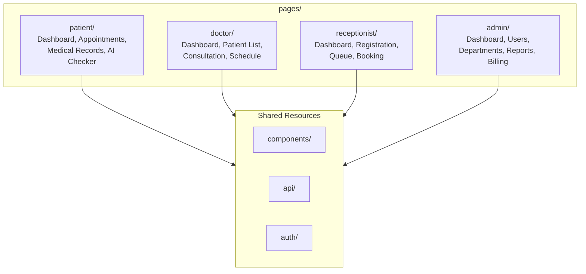

---

## 8. Request Flow: React UI → Spring Boot → Database

This section traces a typical authenticated request through every layer of the system, using **"Book an Appointment"** as the example.

### 8.1 End-to-End Request Flow

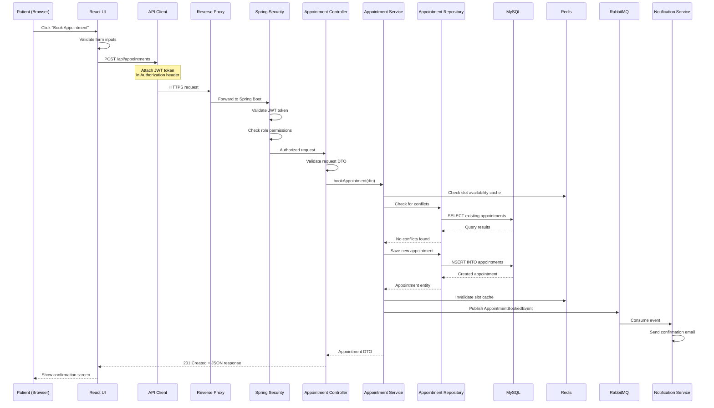

### 8.2 Layer-by-Layer Breakdown

| Step | Layer | What Happens |
|---|---|---|
| 1 | **React UI** | User fills appointment form; client-side validation runs |
| 2 | **API Client** | Axios sends `POST /api/appointments` with JWT in `Authorization: Bearer <token>` header |
| 3 | **Reverse Proxy** | Nginx terminates SSL and forwards to Spring Boot on port 8080 |
| 4 | **Spring Security** | JWT filter validates token signature, expiry, and role (`PATIENT` allowed) |
| 5 | **Controller** | `@RestController` receives request body, validates with `@Valid`, maps to DTO |
| 6 | **Service** | Business logic: check slot availability, prevent double-booking, create appointment |
| 7 | **Repository** | Spring Data JPA persists entity; Hibernate generates SQL |
| 8 | **MySQL** | Transaction commits; appointment row inserted |
| 9 | **Redis** | Slot cache invalidated so next query reflects updated availability |
| 10 | **RabbitMQ** | `AppointmentBookedEvent` published to notification queue |
| 11 | **Notification** | Async consumer sends confirmation email to patient |
| 12 | **Response** | JSON response flows back through layers to React UI |

### 8.3 Authentication Request Flow

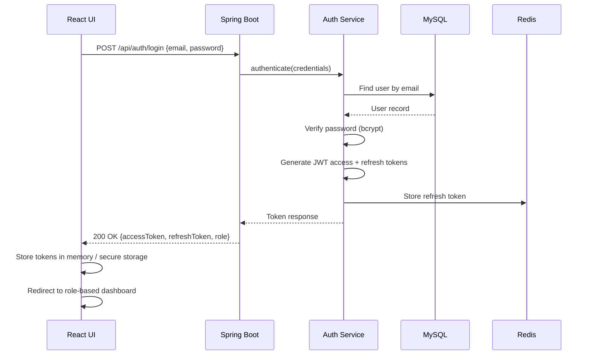

### 8.4 Error Handling Flow

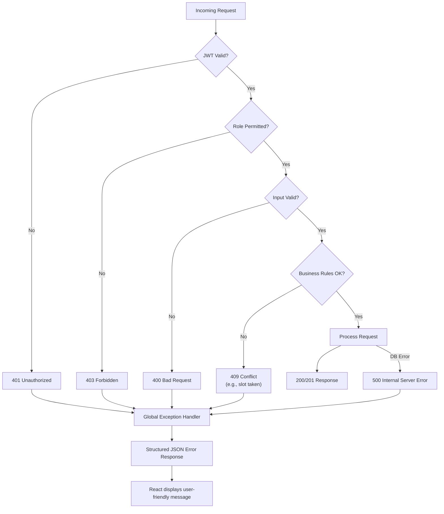

---

## 9. Deployment Architecture Using Docker

The initial deployment uses **Docker Compose** to orchestrate all services on a single host (development) or a small set of hosts (staging/production).

### 9.1 Container Architecture

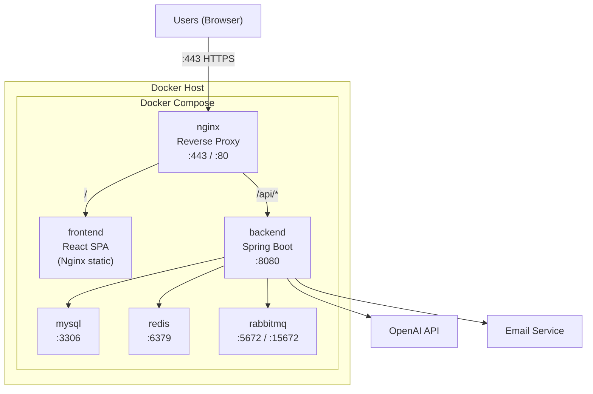

### 9.2 Service Definitions

| Container | Image / Build | Port | Purpose |
|---|---|---|---|
| **nginx** | `nginx:alpine` | 80, 443 | SSL termination, reverse proxy, static file serving |
| **frontend** | Custom (Node build → Nginx) | 80 (internal) | Serves React SPA |
| **backend** | Custom (Java 21 → JRE) | 8080 (internal) | Spring Boot API server |
| **mysql** | `mysql:8.0` | 3306 (internal) | Primary relational database |
| **redis** | `redis:7-alpine` | 6379 (internal) | Caching and session store |
| **rabbitmq** | `rabbitmq:3-management` | 5672, 15672 (internal) | Message broker for async tasks |

### 9.3 Environment Configuration

| Environment | Compose File | Purpose |
|---|---|---|
| **Development** | `docker-compose.yml` | Local development with hot reload |
| **Staging** | `docker-compose.staging.yml` | Pre-production testing |
| **Production** | `docker-compose.prod.yml` | Live deployment with resource limits |

**Environment Variables (Backend):**

| Variable | Description | Example |
|---|---|---|
| `SPRING_PROFILES_ACTIVE` | Active Spring profile | `prod` |
| `DB_HOST` | MySQL hostname | `mysql` |
| `DB_PORT` | MySQL port | `3306` |
| `DB_NAME` | Database name | `hospital_db` |
| `DB_USERNAME` | Database user | `hospital_user` |
| `DB_PASSWORD` | Database password | *(from secrets)* |
| `REDIS_HOST` | Redis hostname | `redis` |
| `RABBITMQ_HOST` | RabbitMQ hostname | `rabbitmq` |
| `JWT_SECRET` | JWT signing key | *(from secrets)* |
| `OPENAI_API_KEY` | OpenAI API key | *(from secrets)* |
| `EMAIL_API_KEY` | Email provider API key | *(from secrets)* |

### 9.4 Network Architecture

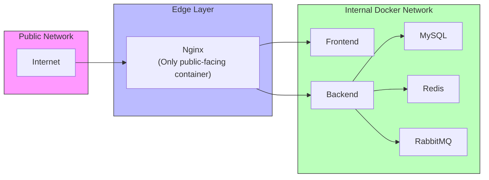

Only the Nginx container exposes ports to the host. All other containers communicate over an internal Docker network and are not directly accessible from outside.

### 9.5 CI/CD Pipeline

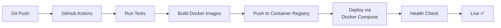

| Stage | Action |
|---|---|
| **Trigger** | Push to `main` branch or merge PR |
| **Test** | Run backend unit/integration tests and frontend lint/build |
| **Build** | Build Docker images for frontend and backend |
| **Push** | Push images to container registry (Docker Hub / GitHub Container Registry) |
| **Deploy** | SSH or pull-based deploy using Docker Compose on target host |
| **Verify** | Health check endpoints (`/actuator/health`) confirm successful deployment |

### 9.6 Data Persistence

| Service | Volume | Purpose |
|---|---|---|
| MySQL | `mysql_data:/var/lib/mysql` | Database files persist across container restarts |
| Redis | `redis_data:/data` | Optional persistence for cache recovery |
| RabbitMQ | `rabbitmq_data:/var/lib/rabbitmq` | Message queue durability |

---

## 10. Future Kubernetes Deployment

When the system outgrows Docker Compose—due to increased traffic, team size, or microservices extraction—Kubernetes (K8s) will provide production-grade orchestration with auto-scaling, self-healing, and zero-downtime deployments.

### 10.1 Target Kubernetes Architecture

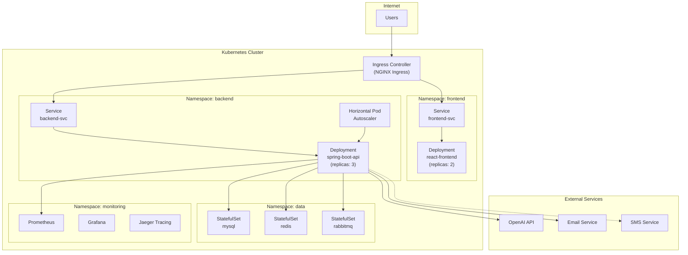

### 10.2 Kubernetes Resources

| Resource | Purpose | Example |
|---|---|---|
| **Deployment** | Stateless app pods (frontend, backend) | `spring-boot-api` with 3 replicas |
| **StatefulSet** | Stateful services (MySQL, Redis, RabbitMQ) | `mysql` with persistent volume claims |
| **Service** | Internal load balancing between pods | `backend-svc` ClusterIP on port 8080 |
| **Ingress** | External HTTP/S routing | Route `/api/*` to backend, `/` to frontend |
| **ConfigMap** | Non-sensitive configuration | Application properties, feature flags |
| **Secret** | Sensitive credentials | DB passwords, API keys, JWT secrets |
| **HPA** | Auto-scaling based on CPU/memory | Scale backend 2→10 pods at 70% CPU |
| **PVC** | Persistent storage for databases | 50Gi SSD for MySQL data |
| **Namespace** | Logical isolation | `frontend`, `backend`, `data`, `monitoring` |

### 10.3 Microservices on Kubernetes

When modules are extracted into microservices, each becomes an independent Deployment:

```mermaid
flowchart TB
    Ingress["API Gateway / Ingress"]

    subgraph Services["Microservices"]
        Auth["Auth Service"]
        Patient["Patient Service"]
        Doctor["Doctor Service"]
        Apt["Appointment Service"]
        EHR["EHR Service"]
        AI["AI Service"]
        Notif["Notification Service"]
        Bill["Billing Service"]
    end

    Ingress --> Auth
    Ingress --> Patient
    Ingress --> Doctor
    Ingress --> Apt
    Ingress --> EHR
    Ingress --> AI
    Ingress --> Notif
    Ingress --> Bill
```

### 10.4 Migration Path: Docker Compose → Kubernetes

| Step | Action | Timeline |
|---|---|---|
| 1 | Containerize all services (already done in Docker phase) | Phase 1 |
| 2 | Create Kubernetes manifests (Deployments, Services, ConfigMaps) | Phase 2 |
| 3 | Set up managed K8s cluster (AWS EKS, GCP GKE, or self-hosted) | Phase 2 |
| 4 | Deploy monolith to K8s with HPA and Ingress | Phase 2 |
| 5 | Add observability stack (Prometheus, Grafana, Jaeger) | Phase 2 |
| 6 | Extract first microservice (Notifications) to separate Deployment | Phase 3 |
| 7 | Introduce service mesh (Istio/Linkerd) for inter-service communication | Phase 3 |
| 8 | Migrate databases to managed services (AWS RDS, ElastiCache, Amazon MQ) | Phase 3 |
| 9 | Full microservices deployment with independent scaling | Phase 3+ |

### 10.5 Observability Stack

```mermaid
flowchart LR
    subgraph Apps["Application Pods"]
        Backend["Spring Boot"]
        Frontend["React"]
    end

    subgraph Observability["Monitoring & Observability"]
        Prom["Prometheus\n(Metrics)"]
        Graf["Grafana\n(Dashboards)"]
        Jaeger["Jaeger\n(Distributed Tracing)"]
        ELK["ELK Stack\n(Centralized Logs)"]
        Alert["Alertmanager\n(Alerts)"]
    end

    Backend -->|"/actuator/prometheus"| Prom
    Backend -->|OpenTelemetry| Jaeger
    Backend -->|JSON logs| ELK
    Prom --> Graf
    Prom --> Alert
```

| Tool | Purpose |
|---|---|
| **Prometheus** | Scrapes metrics from Spring Boot Actuator (`/actuator/prometheus`) |
| **Grafana** | Dashboards for API latency, error rates, appointment volume |
| **Jaeger** | Distributed tracing across microservices (critical post-extraction) |
| **ELK Stack** | Centralized log aggregation and search (Elasticsearch, Logstash, Kibana) |
| **Alertmanager** | Alerts on high error rates, pod crashes, database connection failures |

### 10.6 Cloud Provider Options

| Provider | Kubernetes Service | Managed Database | Managed Cache | Managed MQ |
|---|---|---|---|---|
| **AWS** | EKS | RDS (MySQL) | ElastiCache (Redis) | Amazon MQ (RabbitMQ) |
| **GCP** | GKE | Cloud SQL | Memorystore | N/A (use Pub/Sub) |
| **Azure** | AKS | Azure Database for MySQL | Azure Cache for Redis | Azure Service Bus |

---

## Appendix A: Technology Stack Summary

| Layer | Technology | Version |
|---|---|---|
| Frontend | React + Vite | React 18+, Vite 5+ |
| Routing | React Router | v6+ |
| Backend | Spring Boot | 3.x |
| Language | Java | 21 |
| Security | Spring Security + JWT | — |
| ORM | Spring Data JPA / Hibernate | — |
| Database | MySQL | 8.0+ |
| Cache | Redis | 7+ |
| Messaging | RabbitMQ | 3.x |
| AI | OpenAI API | GPT-4+ |
| Containerization | Docker + Docker Compose | — |
| CI/CD | GitHub Actions | — |
| Orchestration (Future) | Kubernetes | — |
| Cloud (Future) | AWS | — |

---

## Appendix B: Glossary

| Term | Definition |
|---|---|
| **Modular Monolith** | Single deployable application with well-defined internal module boundaries |
| **Microservices** | Independently deployable services, each owning a specific business domain |
| **Strangler Fig Pattern** | Incremental migration strategy that gradually replaces a monolith with services |
| **JWT** | JSON Web Token — stateless authentication token |
| **API Gateway** | Single entry point that routes requests to appropriate backend services |
| **HPA** | Horizontal Pod Autoscaler — K8s resource that auto-scales pods based on metrics |
| **StatefulSet** | K8s resource for managing stateful applications with persistent storage |
| **Ingress** | K8s resource that manages external access to services within the cluster |
| **Circuit Breaker** | Pattern that prevents cascade failures when external services are unavailable |

---

## Appendix C: Document Revision History

| Version | Date | Author | Changes |
|---|---|---|---|
| 1.0 | July 21, 2026 | Architecture Team | Initial system architecture document |

---

## Appendix D: Related Documents

| Document | Location | Description |
|---|---|---|
| Software Requirements Specification | [docs/SRS.md](../docs/SRS.md) | Functional and non-functional requirements |
| README | [README.md](../README.md) | Project overview and getting started |
| Database Schema | [database/](../database/) | MySQL schema and migrations |

---

*End of System Architecture Document*
