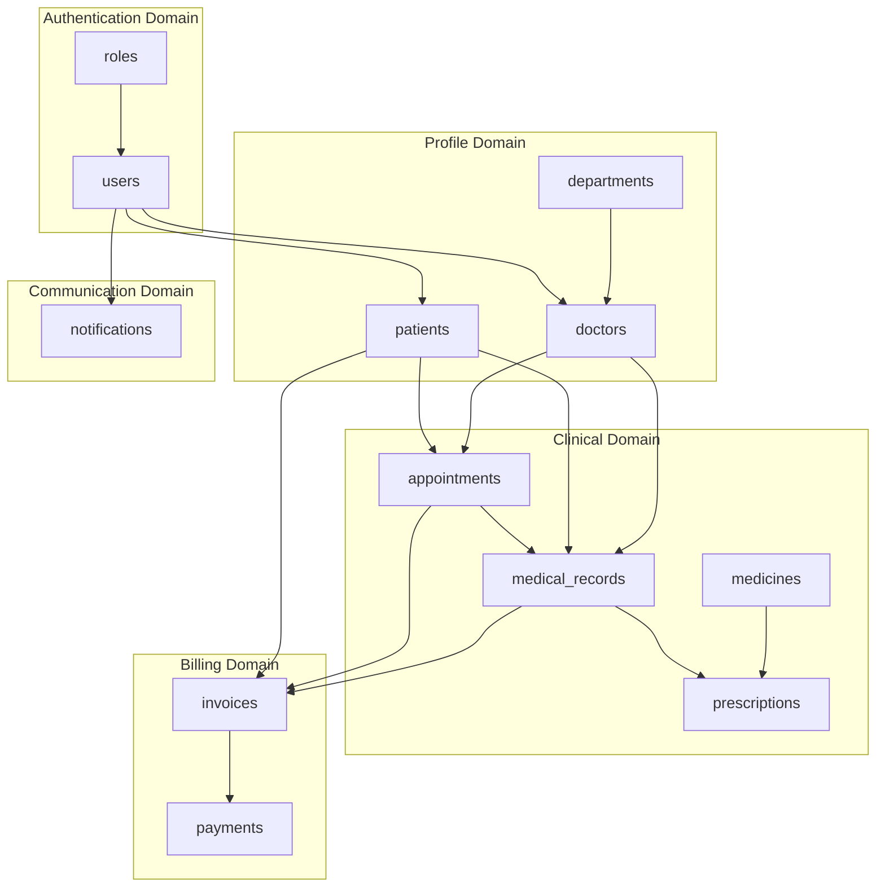
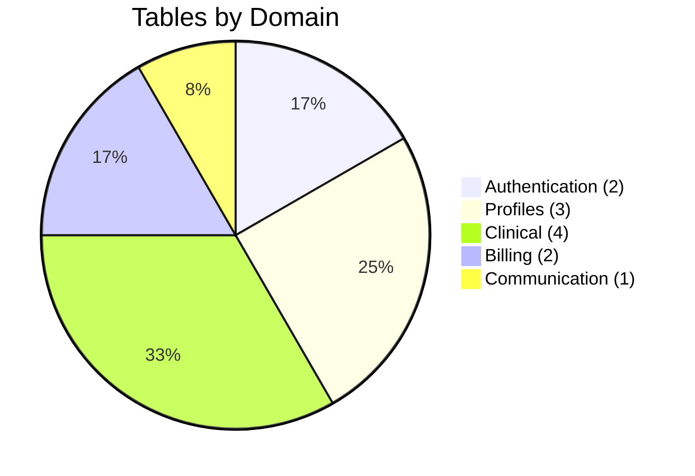

# Database Design

## AI-Powered Smart Hospital Management System

| Document Information | |
|---|---|
| **Project Name** | AI-Powered Smart Hospital Management System |
| **Version** | 1.0 |
| **Date** | July 21, 2026 |
| **Status** | Draft |
| **Prepared By** | Database Architecture Team |
| **Database Engine** | MySQL 8.0+ |
| **Related Documents** | [SRS](../docs/SRS.md), [System Architecture](../architecture/System-Architecture.md) |

---

## Table of Contents

1. [Overview](#1-overview)
2. [List of All Database Tables](#2-list-of-all-database-tables)
3. [Table Definitions](#3-table-definitions)
4. [Entity Relationship Diagram](#4-entity-relationship-diagram)
5. [Table Relationships Explained](#5-table-relationships-explained)
6. [Normalization Principles](#6-normalization-principles)
7. [Indexing Strategy](#7-indexing-strategy)
8. [Naming Conventions](#8-naming-conventions)

---

## 1. Overview

This document defines the complete relational database schema for the AI-Powered Smart Hospital Management System. The database is designed to support:

- User authentication and role-based access control
- Patient and doctor profile management
- Appointment scheduling and visit tracking
- Electronic health records and prescriptions
- Billing, invoicing, and payment tracking
- In-app and email notification delivery

The schema follows **Third Normal Form (3NF)** to eliminate redundancy, ensure data integrity, and maintain flexibility for future growth.

### 1.1 Design Principles

| Principle | Description |
|---|---|
| **Single source of truth** | Each fact is stored in exactly one place |
| **Referential integrity** | Foreign keys enforce valid relationships between tables |
| **Auditability** | `created_at` and `updated_at` timestamps on all tables |
| **Soft deletes** | Critical entities use `is_active` flags instead of hard deletes |
| **Snake_case naming** | All tables and columns use lowercase snake_case |
| **BIGINT primary keys** | Auto-incrementing BIGINT for scalability |

---

## 2. List of All Database Tables

| # | Table Name | Domain | Description |
|---|---|---|---|
| 1 | `roles` | Authentication | Defines system roles (Patient, Doctor, Receptionist, Admin) |
| 2 | `users` | Authentication | Stores login credentials and account information |
| 3 | `departments` | Hospital Structure | Hospital departments (Cardiology, Pediatrics, etc.) |
| 4 | `patients` | Patient Management | Patient demographic and medical profile data |
| 5 | `doctors` | Doctor Management | Doctor professional profiles and credentials |
| 6 | `appointments` | Appointment Management | Scheduled visits between patients and doctors |
| 7 | `medical_records` | EHR | Clinical visit records, diagnoses, and consultation notes |
| 8 | `medicines` | Pharmacy | Master catalog of available medicines |
| 9 | `prescriptions` | EHR / Pharmacy | Prescribed medicines linked to medical records |
| 10 | `invoices` | Billing | Patient billing invoices for services rendered |
| 11 | `payments` | Billing | Payment transactions against invoices |
| 12 | `notifications` | Notifications | User notifications (in-app, email, SMS) |

---

## 3. Table Definitions

### 3.1 `roles`

Defines the four system roles. Stored as a separate table rather than hard-coded enums to allow future role additions without schema changes.

| Column | Data Type | Constraints | Description |
|---|---|---|---|
| `id` | `BIGINT` | `PRIMARY KEY`, `AUTO_INCREMENT` | Unique role identifier |
| `name` | `VARCHAR(50)` | `NOT NULL`, `UNIQUE` | Role name (e.g., `PATIENT`, `DOCTOR`, `RECEPTIONIST`, `ADMIN`) |
| `description` | `VARCHAR(255)` | `NULL` | Human-readable role description |
| `created_at` | `TIMESTAMP` | `NOT NULL`, `DEFAULT CURRENT_TIMESTAMP` | Record creation timestamp |
| `updated_at` | `TIMESTAMP` | `NOT NULL`, `DEFAULT CURRENT_TIMESTAMP ON UPDATE CURRENT_TIMESTAMP` | Last update timestamp |

**Primary Key:** `id`

**Foreign Keys:** None

**Additional Constraints:**
- `CHECK (name IN ('PATIENT', 'DOCTOR', 'RECEPTIONIST', 'ADMIN'))` — validates allowed role names

**Seed Data:**

| id | name | description |
|---|---|---|
| 1 | PATIENT | Patient receiving medical care |
| 2 | DOCTOR | Licensed medical professional |
| 3 | RECEPTIONIST | Front-desk staff |
| 4 | ADMIN | Hospital administrator |

---

### 3.2 `users`

Central authentication table. Every person who logs into the system has a user account linked to exactly one role.

| Column | Data Type | Constraints | Description |
|---|---|---|---|
| `id` | `BIGINT` | `PRIMARY KEY`, `AUTO_INCREMENT` | Unique user identifier |
| `role_id` | `BIGINT` | `NOT NULL`, `FOREIGN KEY → roles(id)` | User's assigned role |
| `email` | `VARCHAR(255)` | `NOT NULL`, `UNIQUE` | Login email address |
| `password_hash` | `VARCHAR(255)` | `NOT NULL` | Bcrypt-hashed password |
| `first_name` | `VARCHAR(100)` | `NOT NULL` | User's first name |
| `last_name` | `VARCHAR(100)` | `NOT NULL` | User's last name |
| `phone` | `VARCHAR(20)` | `NULL` | Contact phone number |
| `is_active` | `BOOLEAN` | `NOT NULL`, `DEFAULT TRUE` | Account active status (soft delete) |
| `is_email_verified` | `BOOLEAN` | `NOT NULL`, `DEFAULT FALSE` | Email verification status |
| `last_login_at` | `TIMESTAMP` | `NULL` | Timestamp of last successful login |
| `created_at` | `TIMESTAMP` | `NOT NULL`, `DEFAULT CURRENT_TIMESTAMP` | Record creation timestamp |
| `updated_at` | `TIMESTAMP` | `NOT NULL`, `DEFAULT CURRENT_TIMESTAMP ON UPDATE CURRENT_TIMESTAMP` | Last update timestamp |

**Primary Key:** `id`

**Foreign Keys:**

| Column | References | On Delete | On Update |
|---|---|---|---|
| `role_id` | `roles(id)` | `RESTRICT` | `CASCADE` |

**Additional Constraints:**
- `UNIQUE (email)` — no duplicate email addresses
- Email format validation enforced at application layer

---

### 3.3 `departments`

Hospital departments that group doctors by medical specialty area.

| Column | Data Type | Constraints | Description |
|---|---|---|---|
| `id` | `BIGINT` | `PRIMARY KEY`, `AUTO_INCREMENT` | Unique department identifier |
| `name` | `VARCHAR(100)` | `NOT NULL`, `UNIQUE` | Department name (e.g., Cardiology) |
| `description` | `TEXT` | `NULL` | Department description |
| `floor_number` | `VARCHAR(10)` | `NULL` | Physical location floor |
| `phone_extension` | `VARCHAR(10)` | `NULL` | Internal phone extension |
| `is_active` | `BOOLEAN` | `NOT NULL`, `DEFAULT TRUE` | Department active status |
| `created_at` | `TIMESTAMP` | `NOT NULL`, `DEFAULT CURRENT_TIMESTAMP` | Record creation timestamp |
| `updated_at` | `TIMESTAMP` | `NOT NULL`, `DEFAULT CURRENT_TIMESTAMP ON UPDATE CURRENT_TIMESTAMP` | Last update timestamp |

**Primary Key:** `id`

**Foreign Keys:** None

**Additional Constraints:**
- `UNIQUE (name)` — no duplicate department names

---

### 3.4 `patients`

Extended profile for users with the Patient role. Contains medical and demographic information beyond basic account data.

| Column | Data Type | Constraints | Description |
|---|---|---|---|
| `id` | `BIGINT` | `PRIMARY KEY`, `AUTO_INCREMENT` | Unique patient identifier |
| `user_id` | `BIGINT` | `NOT NULL`, `UNIQUE`, `FOREIGN KEY → users(id)` | Link to user account (1:1) |
| `date_of_birth` | `DATE` | `NOT NULL` | Patient date of birth |
| `gender` | `ENUM('MALE', 'FEMALE', 'OTHER')` | `NOT NULL` | Patient gender |
| `blood_group` | `ENUM('A+', 'A-', 'B+', 'B-', 'AB+', 'AB-', 'O+', 'O-')` | `NULL` | Blood group |
| `address` | `TEXT` | `NULL` | Residential address |
| `city` | `VARCHAR(100)` | `NULL` | City |
| `state` | `VARCHAR(100)` | `NULL` | State / province |
| `postal_code` | `VARCHAR(20)` | `NULL` | Postal / ZIP code |
| `emergency_contact_name` | `VARCHAR(200)` | `NULL` | Emergency contact person |
| `emergency_contact_phone` | `VARCHAR(20)` | `NULL` | Emergency contact phone |
| `allergies` | `TEXT` | `NULL` | Known allergies (comma-separated or free text) |
| `medical_history` | `TEXT` | `NULL` | Chronic conditions, past surgeries |
| `created_at` | `TIMESTAMP` | `NOT NULL`, `DEFAULT CURRENT_TIMESTAMP` | Record creation timestamp |
| `updated_at` | `TIMESTAMP` | `NOT NULL`, `DEFAULT CURRENT_TIMESTAMP ON UPDATE CURRENT_TIMESTAMP` | Last update timestamp |

**Primary Key:** `id`

**Foreign Keys:**

| Column | References | On Delete | On Update |
|---|---|---|---|
| `user_id` | `users(id)` | `CASCADE` | `CASCADE` |

**Additional Constraints:**
- `UNIQUE (user_id)` — one patient profile per user account

---

### 3.5 `doctors`

Extended profile for users with the Doctor role. Contains professional credentials and department assignment.

| Column | Data Type | Constraints | Description |
|---|---|---|---|
| `id` | `BIGINT` | `PRIMARY KEY`, `AUTO_INCREMENT` | Unique doctor identifier |
| `user_id` | `BIGINT` | `NOT NULL`, `UNIQUE`, `FOREIGN KEY → users(id)` | Link to user account (1:1) |
| `department_id` | `BIGINT` | `NOT NULL`, `FOREIGN KEY → departments(id)` | Assigned department |
| `specialization` | `VARCHAR(150)` | `NOT NULL` | Medical specialization (e.g., Cardiologist) |
| `license_number` | `VARCHAR(50)` | `NOT NULL`, `UNIQUE` | Medical license number |
| `qualification` | `VARCHAR(255)` | `NULL` | Degrees and certifications (e.g., MD, MBBS) |
| `years_of_experience` | `INT` | `NULL`, `CHECK (years_of_experience >= 0)` | Years of practice |
| `consultation_fee` | `DECIMAL(10, 2)` | `NOT NULL`, `DEFAULT 0.00` | Standard consultation fee |
| `bio` | `TEXT` | `NULL` | Professional biography |
| `is_available` | `BOOLEAN` | `NOT NULL`, `DEFAULT TRUE` | Currently accepting appointments |
| `created_at` | `TIMESTAMP` | `NOT NULL`, `DEFAULT CURRENT_TIMESTAMP` | Record creation timestamp |
| `updated_at` | `TIMESTAMP` | `NOT NULL`, `DEFAULT CURRENT_TIMESTAMP ON UPDATE CURRENT_TIMESTAMP` | Last update timestamp |

**Primary Key:** `id`

**Foreign Keys:**

| Column | References | On Delete | On Update |
|---|---|---|---|
| `user_id` | `users(id)` | `CASCADE` | `CASCADE` |
| `department_id` | `departments(id)` | `RESTRICT` | `CASCADE` |

**Additional Constraints:**
- `UNIQUE (user_id)` — one doctor profile per user account
- `UNIQUE (license_number)` — no duplicate medical licenses

---

### 3.6 `appointments`

Scheduled visits between a patient and a doctor. Central to the hospital workflow.

| Column | Data Type | Constraints | Description |
|---|---|---|---|
| `id` | `BIGINT` | `PRIMARY KEY`, `AUTO_INCREMENT` | Unique appointment identifier |
| `patient_id` | `BIGINT` | `NOT NULL`, `FOREIGN KEY → patients(id)` | Patient booking the appointment |
| `doctor_id` | `BIGINT` | `NOT NULL`, `FOREIGN KEY → doctors(id)` | Doctor assigned to the appointment |
| `scheduled_date` | `DATE` | `NOT NULL` | Date of the appointment |
| `scheduled_time` | `TIME` | `NOT NULL` | Start time of the appointment |
| `duration_minutes` | `INT` | `NOT NULL`, `DEFAULT 30` | Expected duration in minutes |
| `status` | `ENUM('SCHEDULED', 'CHECKED_IN', 'IN_PROGRESS', 'COMPLETED', 'CANCELLED', 'NO_SHOW')` | `NOT NULL`, `DEFAULT 'SCHEDULED'` | Current appointment status |
| `reason` | `TEXT` | `NULL` | Reason for visit / symptoms summary |
| `notes` | `TEXT` | `NULL` | Receptionist or system notes |
| `cancellation_reason` | `TEXT` | `NULL` | Reason if cancelled |
| `checked_in_at` | `TIMESTAMP` | `NULL` | When patient checked in |
| `completed_at` | `TIMESTAMP` | `NULL` | When consultation finished |
| `created_at` | `TIMESTAMP` | `NOT NULL`, `DEFAULT CURRENT_TIMESTAMP` | Record creation timestamp |
| `updated_at` | `TIMESTAMP` | `NOT NULL`, `DEFAULT CURRENT_TIMESTAMP ON UPDATE CURRENT_TIMESTAMP` | Last update timestamp |

**Primary Key:** `id`

**Foreign Keys:**

| Column | References | On Delete | On Update |
|---|---|---|---|
| `patient_id` | `patients(id)` | `RESTRICT` | `CASCADE` |
| `doctor_id` | `doctors(id)` | `RESTRICT` | `CASCADE` |

**Additional Constraints:**
- `UNIQUE (doctor_id, scheduled_date, scheduled_time)` — prevents double-booking the same doctor at the same time
- `CHECK (duration_minutes > 0)` — duration must be positive

---

### 3.7 `medical_records`

Clinical records created during or after a patient visit. Stores diagnoses, vitals, and consultation notes.

| Column | Data Type | Constraints | Description |
|---|---|---|---|
| `id` | `BIGINT` | `PRIMARY KEY`, `AUTO_INCREMENT` | Unique medical record identifier |
| `patient_id` | `BIGINT` | `NOT NULL`, `FOREIGN KEY → patients(id)` | Patient this record belongs to |
| `doctor_id` | `BIGINT` | `NOT NULL`, `FOREIGN KEY → doctors(id)` | Doctor who created the record |
| `appointment_id` | `BIGINT` | `NULL`, `UNIQUE`, `FOREIGN KEY → appointments(id)` | Linked appointment (if applicable) |
| `visit_date` | `DATE` | `NOT NULL` | Date of the clinical visit |
| `chief_complaint` | `TEXT` | `NULL` | Primary reason for visit |
| `diagnosis` | `TEXT` | `NULL` | Doctor's diagnosis |
| `diagnosis_code` | `VARCHAR(20)` | `NULL` | ICD-10 or compatible diagnosis code |
| `treatment_plan` | `TEXT` | `NULL` | Recommended treatment plan |
| `consultation_notes` | `TEXT` | `NULL` | Detailed consultation notes |
| `blood_pressure` | `VARCHAR(20)` | `NULL` | e.g., "120/80 mmHg" |
| `heart_rate` | `INT` | `NULL` | Beats per minute |
| `temperature` | `DECIMAL(4, 1)` | `NULL` | Body temperature (°F or °C) |
| `weight_kg` | `DECIMAL(5, 2)` | `NULL` | Patient weight in kilograms |
| `height_cm` | `DECIMAL(5, 2)` | `NULL` | Patient height in centimeters |
| `follow_up_date` | `DATE` | `NULL` | Recommended follow-up date |
| `created_at` | `TIMESTAMP` | `NOT NULL`, `DEFAULT CURRENT_TIMESTAMP` | Record creation timestamp |
| `updated_at` | `TIMESTAMP` | `NOT NULL`, `DEFAULT CURRENT_TIMESTAMP ON UPDATE CURRENT_TIMESTAMP` | Last update timestamp |

**Primary Key:** `id`

**Foreign Keys:**

| Column | References | On Delete | On Update |
|---|---|---|---|
| `patient_id` | `patients(id)` | `RESTRICT` | `CASCADE` |
| `doctor_id` | `doctors(id)` | `RESTRICT` | `CASCADE` |
| `appointment_id` | `appointments(id)` | `SET NULL` | `CASCADE` |

**Additional Constraints:**
- `UNIQUE (appointment_id)` — one medical record per appointment (when linked)

---

### 3.8 `medicines`

Master catalog of medicines available in the hospital pharmacy. Referenced by prescriptions to avoid duplicating medicine data.

| Column | Data Type | Constraints | Description |
|---|---|---|---|
| `id` | `BIGINT` | `PRIMARY KEY`, `AUTO_INCREMENT` | Unique medicine identifier |
| `name` | `VARCHAR(200)` | `NOT NULL` | Brand name of the medicine |
| `generic_name` | `VARCHAR(200)` | `NOT NULL` | Generic / chemical name |
| `manufacturer` | `VARCHAR(200)` | `NULL` | Pharmaceutical manufacturer |
| `category` | `VARCHAR(100)` | `NULL` | Category (e.g., Antibiotic, Analgesic) |
| `dosage_form` | `ENUM('TABLET', 'CAPSULE', 'SYRUP', 'INJECTION', 'CREAM', 'DROPS', 'INHALER', 'OTHER')` | `NOT NULL` | Physical form of the medicine |
| `strength` | `VARCHAR(50)` | `NULL` | Strength (e.g., "500mg", "10ml") |
| `unit_price` | `DECIMAL(10, 2)` | `NOT NULL`, `DEFAULT 0.00` | Price per unit |
| `stock_quantity` | `INT` | `NOT NULL`, `DEFAULT 0` | Current stock level |
| `requires_prescription` | `BOOLEAN` | `NOT NULL`, `DEFAULT TRUE` | Whether a prescription is required |
| `is_active` | `BOOLEAN` | `NOT NULL`, `DEFAULT TRUE` | Medicine available for prescribing |
| `created_at` | `TIMESTAMP` | `NOT NULL`, `DEFAULT CURRENT_TIMESTAMP` | Record creation timestamp |
| `updated_at` | `TIMESTAMP` | `NOT NULL`, `DEFAULT CURRENT_TIMESTAMP ON UPDATE CURRENT_TIMESTAMP` | Last update timestamp |

**Primary Key:** `id`

**Foreign Keys:** None

**Additional Constraints:**
- `UNIQUE (name, strength, dosage_form)` — prevents duplicate medicine entries
- `CHECK (stock_quantity >= 0)` — stock cannot be negative
- `CHECK (unit_price >= 0)` — price cannot be negative

---

### 3.9 `prescriptions`

Individual prescribed medicines linked to a medical record. Each row represents one medicine prescribed during a visit (one prescription line item).

| Column | Data Type | Constraints | Description |
|---|---|---|---|
| `id` | `BIGINT` | `PRIMARY KEY`, `AUTO_INCREMENT` | Unique prescription identifier |
| `medical_record_id` | `BIGINT` | `NOT NULL`, `FOREIGN KEY → medical_records(id)` | Associated medical record |
| `patient_id` | `BIGINT` | `NOT NULL`, `FOREIGN KEY → patients(id)` | Patient receiving the prescription |
| `doctor_id` | `BIGINT` | `NOT NULL`, `FOREIGN KEY → doctors(id)` | Doctor who prescribed |
| `medicine_id` | `BIGINT` | `NOT NULL`, `FOREIGN KEY → medicines(id)` | Prescribed medicine |
| `dosage` | `VARCHAR(100)` | `NOT NULL` | Dosage instructions (e.g., "500mg") |
| `frequency` | `VARCHAR(100)` | `NOT NULL` | How often to take (e.g., "Twice daily") |
| `duration_days` | `INT` | `NOT NULL` | Duration of prescription in days |
| `quantity` | `INT` | `NOT NULL` | Total quantity prescribed |
| `instructions` | `TEXT` | `NULL` | Additional instructions (e.g., "Take after meals") |
| `status` | `ENUM('ACTIVE', 'COMPLETED', 'CANCELLED')` | `NOT NULL`, `DEFAULT 'ACTIVE'` | Prescription status |
| `prescribed_at` | `TIMESTAMP` | `NOT NULL`, `DEFAULT CURRENT_TIMESTAMP` | When prescription was issued |
| `created_at` | `TIMESTAMP` | `NOT NULL`, `DEFAULT CURRENT_TIMESTAMP` | Record creation timestamp |
| `updated_at` | `TIMESTAMP` | `NOT NULL`, `DEFAULT CURRENT_TIMESTAMP ON UPDATE CURRENT_TIMESTAMP` | Last update timestamp |

**Primary Key:** `id`

**Foreign Keys:**

| Column | References | On Delete | On Update |
|---|---|---|---|
| `medical_record_id` | `medical_records(id)` | `RESTRICT` | `CASCADE` |
| `patient_id` | `patients(id)` | `RESTRICT` | `CASCADE` |
| `doctor_id` | `doctors(id)` | `RESTRICT` | `CASCADE` |
| `medicine_id` | `medicines(id)` | `RESTRICT` | `CASCADE` |

**Additional Constraints:**
- `CHECK (duration_days > 0)` — duration must be at least one day
- `CHECK (quantity > 0)` — quantity must be positive

---

### 3.10 `invoices`

Billing invoices generated for patient services, typically after a completed appointment or visit.

| Column | Data Type | Constraints | Description |
|---|---|---|---|
| `id` | `BIGINT` | `PRIMARY KEY`, `AUTO_INCREMENT` | Unique invoice identifier |
| `invoice_number` | `VARCHAR(30)` | `NOT NULL`, `UNIQUE` | Human-readable invoice number (e.g., INV-2026-00001) |
| `patient_id` | `BIGINT` | `NOT NULL`, `FOREIGN KEY → patients(id)` | Patient being billed |
| `appointment_id` | `BIGINT` | `NULL`, `FOREIGN KEY → appointments(id)` | Related appointment (if applicable) |
| `medical_record_id` | `BIGINT` | `NULL`, `FOREIGN KEY → medical_records(id)` | Related medical record (if applicable) |
| `subtotal` | `DECIMAL(12, 2)` | `NOT NULL`, `DEFAULT 0.00` | Sum of line items before tax |
| `tax_amount` | `DECIMAL(12, 2)` | `NOT NULL`, `DEFAULT 0.00` | Tax amount |
| `discount_amount` | `DECIMAL(12, 2)` | `NOT NULL`, `DEFAULT 0.00` | Discount applied |
| `total_amount` | `DECIMAL(12, 2)` | `NOT NULL` | Final amount due |
| `status` | `ENUM('DRAFT', 'ISSUED', 'PARTIALLY_PAID', 'PAID', 'OVERDUE', 'CANCELLED')` | `NOT NULL`, `DEFAULT 'DRAFT'` | Invoice payment status |
| `due_date` | `DATE` | `NULL` | Payment due date |
| `issued_at` | `TIMESTAMP` | `NULL` | When invoice was issued to patient |
| `notes` | `TEXT` | `NULL` | Billing notes |
| `created_at` | `TIMESTAMP` | `NOT NULL`, `DEFAULT CURRENT_TIMESTAMP` | Record creation timestamp |
| `updated_at` | `TIMESTAMP` | `NOT NULL`, `DEFAULT CURRENT_TIMESTAMP ON UPDATE CURRENT_TIMESTAMP` | Last update timestamp |

**Primary Key:** `id`

**Foreign Keys:**

| Column | References | On Delete | On Update |
|---|---|---|---|
| `patient_id` | `patients(id)` | `RESTRICT` | `CASCADE` |
| `appointment_id` | `appointments(id)` | `SET NULL` | `CASCADE` |
| `medical_record_id` | `medical_records(id)` | `SET NULL` | `CASCADE` |

**Additional Constraints:**
- `UNIQUE (invoice_number)` — no duplicate invoice numbers
- `CHECK (total_amount >= 0)` — total cannot be negative
- `CHECK (subtotal >= 0 AND tax_amount >= 0 AND discount_amount >= 0)`

---

### 3.11 `payments`

Payment transactions recorded against invoices. Supports partial and full payments.

| Column | Data Type | Constraints | Description |
|---|---|---|---|
| `id` | `BIGINT` | `PRIMARY KEY`, `AUTO_INCREMENT` | Unique payment identifier |
| `invoice_id` | `BIGINT` | `NOT NULL`, `FOREIGN KEY → invoices(id)` | Invoice being paid |
| `patient_id` | `BIGINT` | `NOT NULL`, `FOREIGN KEY → patients(id)` | Patient making the payment |
| `amount` | `DECIMAL(12, 2)` | `NOT NULL` | Payment amount |
| `payment_method` | `ENUM('CASH', 'CREDIT_CARD', 'DEBIT_CARD', 'UPI', 'BANK_TRANSFER', 'INSURANCE')` | `NOT NULL` | Method of payment |
| `transaction_reference` | `VARCHAR(100)` | `NULL` | External transaction ID (gateway reference) |
| `status` | `ENUM('PENDING', 'COMPLETED', 'FAILED', 'REFUNDED')` | `NOT NULL`, `DEFAULT 'PENDING'` | Payment status |
| `paid_at` | `TIMESTAMP` | `NULL` | When payment was completed |
| `notes` | `TEXT` | `NULL` | Payment notes |
| `created_at` | `TIMESTAMP` | `NOT NULL`, `DEFAULT CURRENT_TIMESTAMP` | Record creation timestamp |
| `updated_at` | `TIMESTAMP` | `NOT NULL`, `DEFAULT CURRENT_TIMESTAMP ON UPDATE CURRENT_TIMESTAMP` | Last update timestamp |

**Primary Key:** `id`

**Foreign Keys:**

| Column | References | On Delete | On Update |
|---|---|---|---|
| `invoice_id` | `invoices(id)` | `RESTRICT` | `CASCADE` |
| `patient_id` | `patients(id)` | `RESTRICT` | `CASCADE` |

**Additional Constraints:**
- `CHECK (amount > 0)` — payment amount must be positive

---

### 3.12 `notifications`

Stores all notifications sent to users—both in-app messages and records of email/SMS delivery.

| Column | Data Type | Constraints | Description |
|---|---|---|---|
| `id` | `BIGINT` | `PRIMARY KEY`, `AUTO_INCREMENT` | Unique notification identifier |
| `user_id` | `BIGINT` | `NOT NULL`, `FOREIGN KEY → users(id)` | Recipient user |
| `type` | `ENUM('APPOINTMENT_CONFIRMATION', 'APPOINTMENT_REMINDER', 'APPOINTMENT_CANCELLATION', 'PRESCRIPTION_READY', 'INVOICE_ISSUED', 'PAYMENT_RECEIPT', 'PASSWORD_RESET', 'SYSTEM_ALERT', 'GENERAL')` | `NOT NULL` | Notification category |
| `channel` | `ENUM('IN_APP', 'EMAIL', 'SMS')` | `NOT NULL`, `DEFAULT 'IN_APP'` | Delivery channel |
| `title` | `VARCHAR(255)` | `NOT NULL` | Notification title |
| `message` | `TEXT` | `NOT NULL` | Notification body content |
| `is_read` | `BOOLEAN` | `NOT NULL`, `DEFAULT FALSE` | Whether user has read the notification |
| `read_at` | `TIMESTAMP` | `NULL` | When notification was read |
| `sent_at` | `TIMESTAMP` | `NULL` | When notification was delivered |
| `reference_type` | `VARCHAR(50)` | `NULL` | Related entity type (e.g., `APPOINTMENT`, `INVOICE`) |
| `reference_id` | `BIGINT` | `NULL` | Related entity ID (polymorphic reference) |
| `created_at` | `TIMESTAMP` | `NOT NULL`, `DEFAULT CURRENT_TIMESTAMP` | Record creation timestamp |
| `updated_at` | `TIMESTAMP` | `NOT NULL`, `DEFAULT CURRENT_TIMESTAMP ON UPDATE CURRENT_TIMESTAMP` | Last update timestamp |

**Primary Key:** `id`

**Foreign Keys:**

| Column | References | On Delete | On Update |
|---|---|---|---|
| `user_id` | `users(id)` | `CASCADE` | `CASCADE` |

**Additional Constraints:**
- `reference_type` and `reference_id` together form a polymorphic association to related entities (not enforced by FK, validated at application layer)

---

## 4. Entity Relationship Diagram

```mermaid
erDiagram
    roles ||--o{ users : "has"
    users ||--o| patients : "profile"
    users ||--o| doctors : "profile"
    departments ||--o{ doctors : "employs"
    patients ||--o{ appointments : "books"
    doctors ||--o{ appointments : "handles"
    patients ||--o{ medical_records : "owns"
    doctors ||--o{ medical_records : "creates"
    appointments ||--o| medical_records : "generates"
    medical_records ||--o{ prescriptions : "includes"
    patients ||--o{ prescriptions : "receives"
    doctors ||--o{ prescriptions : "writes"
    medicines ||--o{ prescriptions : "prescribed_in"
    patients ||--o{ invoices : "billed_to"
    appointments ||--o| invoices : "may_generate"
    medical_records ||--o| invoices : "may_generate"
    invoices ||--o{ payments : "paid_by"
    patients ||--o{ payments : "makes"
    users ||--o{ notifications : "receives"

    roles {
        bigint id PK
        varchar name UK
        varchar description
        timestamp created_at
        timestamp updated_at
    }

    users {
        bigint id PK
        bigint role_id FK
        varchar email UK
        varchar password_hash
        varchar first_name
        varchar last_name
        varchar phone
        boolean is_active
        boolean is_email_verified
        timestamp last_login_at
        timestamp created_at
        timestamp updated_at
    }

    departments {
        bigint id PK
        varchar name UK
        text description
        varchar floor_number
        varchar phone_extension
        boolean is_active
        timestamp created_at
        timestamp updated_at
    }

    patients {
        bigint id PK
        bigint user_id FK_UK
        date date_of_birth
        enum gender
        enum blood_group
        text address
        varchar city
        varchar state
        varchar postal_code
        varchar emergency_contact_name
        varchar emergency_contact_phone
        text allergies
        text medical_history
        timestamp created_at
        timestamp updated_at
    }

    doctors {
        bigint id PK
        bigint user_id FK_UK
        bigint department_id FK
        varchar specialization
        varchar license_number UK
        varchar qualification
        int years_of_experience
        decimal consultation_fee
        text bio
        boolean is_available
        timestamp created_at
        timestamp updated_at
    }

    appointments {
        bigint id PK
        bigint patient_id FK
        bigint doctor_id FK
        date scheduled_date
        time scheduled_time
        int duration_minutes
        enum status
        text reason
        text notes
        text cancellation_reason
        timestamp checked_in_at
        timestamp completed_at
        timestamp created_at
        timestamp updated_at
    }

    medical_records {
        bigint id PK
        bigint patient_id FK
        bigint doctor_id FK
        bigint appointment_id FK_UK
        date visit_date
        text chief_complaint
        text diagnosis
        varchar diagnosis_code
        text treatment_plan
        text consultation_notes
        varchar blood_pressure
        int heart_rate
        decimal temperature
        decimal weight_kg
        decimal height_cm
        date follow_up_date
        timestamp created_at
        timestamp updated_at
    }

    medicines {
        bigint id PK
        varchar name
        varchar generic_name
        varchar manufacturer
        varchar category
        enum dosage_form
        varchar strength
        decimal unit_price
        int stock_quantity
        boolean requires_prescription
        boolean is_active
        timestamp created_at
        timestamp updated_at
    }

    prescriptions {
        bigint id PK
        bigint medical_record_id FK
        bigint patient_id FK
        bigint doctor_id FK
        bigint medicine_id FK
        varchar dosage
        varchar frequency
        int duration_days
        int quantity
        text instructions
        enum status
        timestamp prescribed_at
        timestamp created_at
        timestamp updated_at
    }

    invoices {
        bigint id PK
        varchar invoice_number UK
        bigint patient_id FK
        bigint appointment_id FK
        bigint medical_record_id FK
        decimal subtotal
        decimal tax_amount
        decimal discount_amount
        decimal total_amount
        enum status
        date due_date
        timestamp issued_at
        text notes
        timestamp created_at
        timestamp updated_at
    }

    payments {
        bigint id PK
        bigint invoice_id FK
        bigint patient_id FK
        decimal amount
        enum payment_method
        varchar transaction_reference
        enum status
        timestamp paid_at
        text notes
        timestamp created_at
        timestamp updated_at
    }

    notifications {
        bigint id PK
        bigint user_id FK
        enum type
        enum channel
        varchar title
        text message
        boolean is_read
        timestamp read_at
        timestamp sent_at
        varchar reference_type
        bigint reference_id
        timestamp created_at
        timestamp updated_at
    }
```

---

## 5. Table Relationships Explained

This section describes every relationship between tables, including cardinality and business meaning.

### 5.1 Relationship Summary Table

| # | Parent Table | Child Table | Relationship | Cardinality | Description |
|---|---|---|---|---|---|
| 1 | `roles` | `users` | Role assignment | One-to-Many | One role can be assigned to many users; each user has exactly one role |
| 2 | `users` | `patients` | User profile | One-to-One | One user account maps to at most one patient profile |
| 3 | `users` | `doctors` | User profile | One-to-One | One user account maps to at most one doctor profile |
| 4 | `departments` | `doctors` | Department assignment | One-to-Many | One department employs many doctors; each doctor belongs to one department |
| 5 | `patients` | `appointments` | Booking | One-to-Many | One patient can book many appointments |
| 6 | `doctors` | `appointments` | Handling | One-to-Many | One doctor can handle many appointments |
| 7 | `patients` | `medical_records` | Record ownership | One-to-Many | One patient can have many medical records over time |
| 8 | `doctors` | `medical_records` | Record creation | One-to-Many | One doctor can create many medical records |
| 9 | `appointments` | `medical_records` | Visit documentation | One-to-One | One appointment generates at most one medical record |
| 10 | `medical_records` | `prescriptions` | Prescription context | One-to-Many | One medical record can include many prescribed medicines |
| 11 | `patients` | `prescriptions` | Prescription recipient | One-to-Many | One patient can receive many prescriptions over time |
| 12 | `doctors` | `prescriptions` | Prescription author | One-to-Many | One doctor can write many prescriptions |
| 13 | `medicines` | `prescriptions` | Medicine reference | One-to-Many | One medicine can appear in many prescriptions |
| 14 | `patients` | `invoices` | Billing | One-to-Many | One patient can receive many invoices |
| 15 | `appointments` | `invoices` | Service billing | One-to-One | One appointment may generate one invoice |
| 16 | `medical_records` | `invoices` | Service billing | One-to-One | One medical record may generate one invoice |
| 17 | `invoices` | `payments` | Payment tracking | One-to-Many | One invoice can have many partial payments |
| 18 | `patients` | `payments` | Payment maker | One-to-Many | One patient can make many payments |
| 19 | `users` | `notifications` | Notification delivery | One-to-Many | One user can receive many notifications |

### 5.2 Detailed Relationship Descriptions

#### Roles ↔ Users

```
roles (1) ──────── (N) users
```

Every user must have exactly one role (`role_id` FK). The `roles` table is the master list; user accounts reference it. This avoids storing role names as plain text in the `users` table, which would cause update anomalies if a role name changes.

A user is either a Patient, Doctor, Receptionist, or Admin — never multiple roles simultaneously in the initial design.

---

#### Users ↔ Patients / Doctors

```
users (1) ──────── (0..1) patients
users (1) ──────── (0..1) doctors
```

The `users` table stores authentication data shared by all roles. Role-specific profile data lives in extension tables:

- **Patients** get a row in `patients` with medical/demographic data
- **Doctors** get a row in `doctors` with professional credentials
- **Receptionists and Admins** use only the `users` table (no extension table needed)

The `UNIQUE` constraint on `user_id` in both `patients` and `doctors` enforces the one-to-one relationship.

---

#### Departments ↔ Doctors

```
departments (1) ──────── (N) doctors
```

Each doctor belongs to exactly one department (e.g., Cardiology, Pediatrics). A department can have many doctors. If a department is deactivated, existing doctor records are preserved (`ON DELETE RESTRICT`).

---

#### Patients + Doctors ↔ Appointments

```
patients (1) ──────── (N) appointments (N) ──────── (1) doctors
```

Appointments are the junction entity connecting patients and doctors. Each appointment references exactly one patient and one doctor. The unique constraint on `(doctor_id, scheduled_date, scheduled_time)` prevents scheduling conflicts.

---

#### Appointments ↔ Medical Records

```
appointments (1) ──────── (0..1) medical_records
```

When a consultation is completed, a medical record is created and optionally linked to the appointment via `appointment_id`. The unique constraint ensures at most one medical record per appointment. Walk-in visits without a prior appointment can still create medical records with a NULL `appointment_id`.

---

#### Medical Records ↔ Prescriptions ↔ Medicines

```
medical_records (1) ──────── (N) prescriptions (N) ──────── (1) medicines
```

Prescriptions are the link between clinical visits and the medicine catalog:

- Each prescription row belongs to one medical record (the visit context)
- Each prescription row references one medicine from the catalog
- A single visit can produce multiple prescription rows (one per medicine)

The `medicines` table acts as a master catalog. Medicine names, prices, and stock are stored once and referenced by all prescriptions — avoiding duplication.

---

#### Patients ↔ Invoices ↔ Payments

```
patients (1) ──────── (N) invoices (1) ──────── (N) payments
```

The billing chain flows as follows:

1. A completed appointment or medical record may trigger invoice creation
2. An invoice belongs to one patient and tracks the total amount due
3. Payments are recorded against invoices — multiple partial payments are supported
4. Invoice status (`PARTIALLY_PAID`, `PAID`) is updated based on cumulative payments

Both `appointment_id` and `medical_record_id` on invoices are optional, allowing invoices for services not tied to a specific visit.

---

#### Users ↔ Notifications

```
users (1) ──────── (N) notifications
```

Every notification is delivered to a user. The `reference_type` and `reference_id` columns create a flexible link to the entity that triggered the notification (e.g., an appointment or invoice) without requiring a foreign key for each possible entity type.

---

### 5.3 Relationship Diagram (Simplified)



---

## 6. Normalization Principles

This database schema is designed to comply with **Third Normal Form (3NF)**. This section explains what normalization means, which normal forms we satisfy, and why it matters for this hospital system.

### 6.1 What Is Normalization?

Normalization is the process of organizing data in a relational database to:

- **Eliminate redundancy** — store each fact in only one place
- **Prevent update anomalies** — changing data in one place doesn't require changes elsewhere
- **Ensure data integrity** — foreign keys and constraints keep data consistent
- **Improve maintainability** — schema changes are localized to specific tables

### 6.2 First Normal Form (1NF)

**Rule:** Each column holds a single atomic (indivisible) value, and each row is unique.

**How we comply:**

| Example | Compliance |
|---|---|
| Patient address split into `address`, `city`, `state`, `postal_code` | Each field holds one atomic value, not a combined string |
| Appointment date and time stored as separate `scheduled_date` and `scheduled_time` columns | Allows independent querying and indexing |
| Every table has a primary key (`id`) | Guarantees row uniqueness |
| No repeating column groups (e.g., `medicine_1`, `medicine_2`) | Prescriptions use separate rows instead |

**What we avoid:**

```
❌ BAD (violates 1NF):
appointments: id | patient | doctor | medicine_1 | medicine_2 | medicine_3

✅ GOOD (1NF compliant):
prescriptions: id | medical_record_id | medicine_id | dosage | frequency
```

Each prescribed medicine gets its own row in `prescriptions`, linked to the medicine catalog.

---

### 6.3 Second Normal Form (2NF)

**Rule:** The table is in 1NF, and every non-key column depends on the **entire** primary key (no partial dependencies). This applies primarily to tables with composite primary keys.

**How we comply:**

All tables use a single-column surrogate primary key (`id`), which automatically satisfies 2NF. However, the principle still guides our design:

| Example | Compliance |
|---|---|
| Medicine name stored in `medicines`, not repeated in `prescriptions` | Prescription depends on `medicine_id` (the whole key), not partially on medicine attributes |
| Doctor specialization stored in `doctors`, not in `appointments` | Appointment depends on `doctor_id`, not on doctor attributes directly |
| Role name stored in `roles`, not duplicated in `users` | User depends on `role_id` FK, not on a denormalized role name column |

**What we avoid:**

```
❌ BAD (violates 2NF):
prescriptions: id | medicine_name | medicine_price | dosage
               ↑ medicine_name and medicine_price depend only on medicine,
                 not on the prescription id

✅ GOOD (2NF compliant):
medicines: id | name | unit_price
prescriptions: id | medicine_id (FK) | dosage | frequency
```

---

### 6.4 Third Normal Form (3NF)

**Rule:** The table is in 2NF, and no non-key column depends on another non-key column (no transitive dependencies).

**How we comply:**

| Example | Compliance |
|---|---|
| User email in `users`, not in `patients` or `doctors` | Patient profile depends on `user_id`, not on user attributes stored redundantly |
| Department name in `departments`, not in `doctors` | Doctor depends on `department_id`, not on a denormalized department name |
| Login credentials separated from profile data | `users` holds auth data; `patients`/`doctors` hold domain-specific data |
| Invoice totals calculated from components | `subtotal`, `tax_amount`, `discount_amount` are stored separately; `total_amount` is derived |

**What we avoid:**

```
❌ BAD (violates 3NF):
doctors: id | name | department_name | department_floor
          ↑ department_floor depends on department_name, not on doctor id

✅ GOOD (3NF compliant):
departments: id | name | floor_number
doctors: id | department_id (FK) | specialization
```

---

### 6.5 Normalization Benefits for This System

| Benefit | Real-World Impact |
|---|---|
| **No duplicate medicine data** | Updating a medicine price in `medicines` automatically applies to all future prescriptions |
| **Consistent role management** | Renaming a role in `roles` updates the meaning for all users referencing it |
| **Clean user/profile separation** | Deactivating a user account (`is_active = FALSE`) is independent of preserving medical history |
| **Reliable billing** | Invoice and payment tables are separate, supporting partial payments without data duplication |
| **Audit-friendly medical records** | Each visit, diagnosis, and prescription is an independent, timestamped record |
| **Flexible notifications** | One notification table serves all user roles and notification types |

### 6.6 Intentional Denormalization

In a few cases, we accept minor redundancy for practical performance reasons while staying within 3NF:

| Column | Table | Reason |
|---|---|---|
| `patient_id` | `prescriptions` | Avoids joining through `medical_records` for common patient prescription queries |
| `doctor_id` | `prescriptions` | Allows direct doctor prescription history queries |
| `patient_id` | `payments` | Enables direct patient payment history without joining through `invoices` |

These FKs reference the same entities already linked through other paths, but they eliminate expensive joins for frequently accessed queries. This is a standard trade-off in production database design.

---

## 7. Indexing Strategy

Recommended indexes beyond primary keys and unique constraints:

| Table | Index | Columns | Purpose |
|---|---|---|---|
| `users` | `idx_users_role_id` | `role_id` | Filter users by role |
| `users` | `idx_users_email` | `email` | Login lookup (covered by UNIQUE) |
| `patients` | `idx_patients_user_id` | `user_id` | Profile lookup by user |
| `doctors` | `idx_doctors_department_id` | `department_id` | List doctors by department |
| `doctors` | `idx_doctors_specialization` | `specialization` | Search doctors by specialty |
| `appointments` | `idx_appointments_patient_id` | `patient_id` | Patient appointment history |
| `appointments` | `idx_appointments_doctor_date` | `doctor_id`, `scheduled_date` | Doctor daily schedule |
| `appointments` | `idx_appointments_status` | `status` | Filter by appointment status |
| `medical_records` | `idx_medical_records_patient_id` | `patient_id` | Patient medical history |
| `prescriptions` | `idx_prescriptions_patient_id` | `patient_id` | Active prescriptions for patient |
| `prescriptions` | `idx_prescriptions_medical_record_id` | `medical_record_id` | Prescriptions per visit |
| `invoices` | `idx_invoices_patient_id` | `patient_id` | Patient billing history |
| `invoices` | `idx_invoices_status` | `status` | Filter unpaid/overdue invoices |
| `payments` | `idx_payments_invoice_id` | `invoice_id` | Payments per invoice |
| `notifications` | `idx_notifications_user_read` | `user_id`, `is_read` | Unread notifications for user |

---

## 8. Naming Conventions

| Element | Convention | Example |
|---|---|---|
| Table names | Plural, snake_case | `medical_records`, `appointments` |
| Column names | Singular, snake_case | `first_name`, `scheduled_date` |
| Primary keys | `id` | `id BIGINT AUTO_INCREMENT` |
| Foreign keys | `{referenced_table_singular}_id` | `patient_id`, `doctor_id` |
| Boolean columns | `is_` or `has_` prefix | `is_active`, `is_read` |
| Timestamps | `_at` suffix | `created_at`, `paid_at` |
| Enum values | UPPER_SNAKE_CASE | `SCHEDULED`, `IN_PROGRESS` |
| Indexes | `idx_{table}_{columns}` | `idx_appointments_doctor_date` |
| Unique constraints | `uk_{table}_{columns}` | `uk_users_email` |

---

## Appendix A: Entity Count Summary



| Domain | Tables | Count |
|---|---|---|
| Authentication | `roles`, `users` | 2 |
| Profiles | `departments`, `patients`, `doctors` | 3 |
| Clinical | `appointments`, `medical_records`, `medicines`, `prescriptions` | 4 |
| Billing | `invoices`, `payments` | 2 |
| Communication | `notifications` | 1 |
| **Total** | | **12** |

---

## Appendix B: Document Revision History

| Version | Date | Author | Changes |
|---|---|---|---|
| 1.0 | July 21, 2026 | Database Architecture Team | Initial database design document |

---

## Appendix C: Related Documents

| Document | Location | Description |
|---|---|---|
| Software Requirements Specification | [docs/SRS.md](../docs/SRS.md) | Functional and non-functional requirements |
| System Architecture | [architecture/System-Architecture.md](../architecture/System-Architecture.md) | Application and infrastructure architecture |
| README | [README.md](../README.md) | Project overview and technology stack |

---

*End of Database Design Document*
